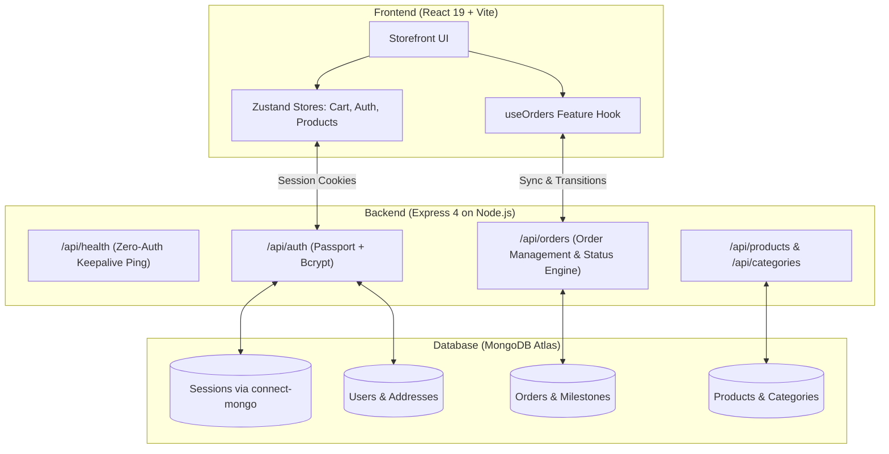

# GoodFind

Curated direct-to-consumer (D2C) commerce storefront and order fulfillment platform engineered for workspace provisions, studio audio gear, everyday linen apparel, and handcrafted home objects.

---

## How to run this project locally?

### 1. Install Dependencies

```bash
npm install
```

### 2. Configure Environment Variables

```bash
cp backend/.env.example backend/.env
```

### 3. Seed Database (Optional / Initial Setup)

```bash
npm run seed
```

### 4. Run Development Servers

```bash
# Start backend API (Port 5000)
npm run dev:backend

# Start frontend storefront (Port 5173)
npm run dev:frontend
```

Storefront runs at `http://localhost:5173` and proxies API requests to `http://localhost:5000`.

---

## 🎨 UI/UX Architecture & Design Philosophy

GoodFind's interface is built around high-clarity typography, deliberate spatial rhythm, and low-friction shopping interactions.

### 1. Visual Hierarchy & Typography

- **Primary Typeface**: `Plus Jakarta Sans` — high legibility geometric sans-serif for marketing headlines, navigation, and body copy.
- **Monospace Accent**: `JetBrains Mono` — utilized for SKUs, order identifiers (`GF-XXXXX`), carrier tracking numbers, and financial data to ensure instant scanability.
- **Elevation & Surface Tokens**: Translucent layered cards (`bg-card/70 backdrop-blur-sm`), fine-line borders (`border-border/80`), and diffused shadows (`shadow-soft` to `shadow-card`) to give physical weight to interactive modules.

### 2. Micro-Interactions & Usability

- **Flicker-Free Account Dropdown**: Engineered with a transparent hover-bridge collider between the topbar trigger and popover pane, eliminating mouse-gap flickering.
- **Optimistic Cart & Quantity Controls**: Cart adjustments, item removals, and stock checks occur instantly in local memory before server confirmation.
- **Real-Time Search & Autocomplete**: Multi-attribute search indexing title, category, tags, and material specifications.
- **Accessible Color Modes**: HSL CSS variable tokens supporting full contrast adherence across Dark and Light themes.

---

## 🏛️ System Design Implementation



### 1. Dual-Layer State Architecture

- **Client Persistence**: Cart items, guest preferences, and active currency selection (INR / USD) are managed via Zustand and persisted to `localStorage`.
- **Database Synchronization**: Authenticated user orders and profiles synchronize directly with MongoDB Atlas. Newly created accounts display isolated purchase histories without mock data bleeding.

### 2. Resilient Production Session Storage

- Migrated from in-memory stores to **`connect-mongo`** to prevent memory leaks and ensure horizontal process scalability.
- User sessions persist across server restarts with a 14-day time-to-live (`TTL`).

### 3. Order Lifecycle & 7-Day Return Policy

- **Cancellation**: Allowed self-service cancellation exclusively for orders in `placed` or `processing` status.
- **7-Day Happiness Guarantee**: Return requests are enabled for `delivered` orders within 7 calendar days of delivery. Initiating a return automatically provisions an RMA tracking ID (`RET-XXXXXX`) and downloadable return label.
- **Split-Shipments**: Multi-item orders automatically derive distinct fulfillment packages, tracking numbers, and status steppers.

### 4. Zero-Dependency Keepalive Health Probe

- Route: `GET /api/health`
- Returns `{ status: 'ok', timestamp: '...' }` in `< 2ms` without invoking database queries.
- Compatible with external uptime pingers (every 14 minutes) to eliminate cold starts on container platforms like Render.

---

## 📁 Repository Structure

```text
GoodFind/
├── frontend/               # React 19 storefront application
│   ├── public/             # Static assets, robots.txt, llms.txt, openapi.json
│   ├── src/
│   │   ├── components/     # Reusable UI primitives (cart, navigation, modals)
│   │   ├── features/       # Domain-driven features (orders tracking, returns)
│   │   ├── pages/          # Catalog, Checkout, Policies, Product Detail
│   │   ├── store/          # Zustand commerce stores (cart, auth, products)
│   │   └── data/           # Product definitions and prebaked static data
│   └── vite.config.js      # Vite build configuration with Rollup chunking
├── backend/                # Express REST API
│   ├── models/             # Mongoose schemas (User, Order, Product, Category)
│   ├── routes/             # API route handlers (auth, orders, products, health)
│   ├── db.js               # MongoDB connection lifecycle
│   └── index.js            # Express application entrypoint
├── SYSTEM_DESIGN.md        # Comprehensive technical specification
├── package.json            # Workspace root configuration
└── .gitignore              # Ignores local dev tools & community-generator/
```

---

## 🤖 Machine-Readable Specifications

- **AI Crawler Map**: [`/llms.txt`](frontend/public/llms.txt) — Domain overview for LLM research tools.
- **OpenAPI 3.0 API Schema**: [`/openapi.json`](frontend/public/openapi.json) — Full REST endpoint contract.
- **System Design Document**: [`SYSTEM_DESIGN.md`](SYSTEM_DESIGN.md) — Architectural specifications.
