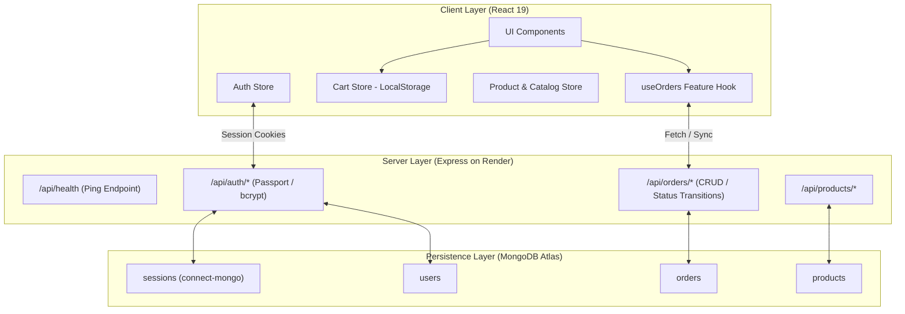
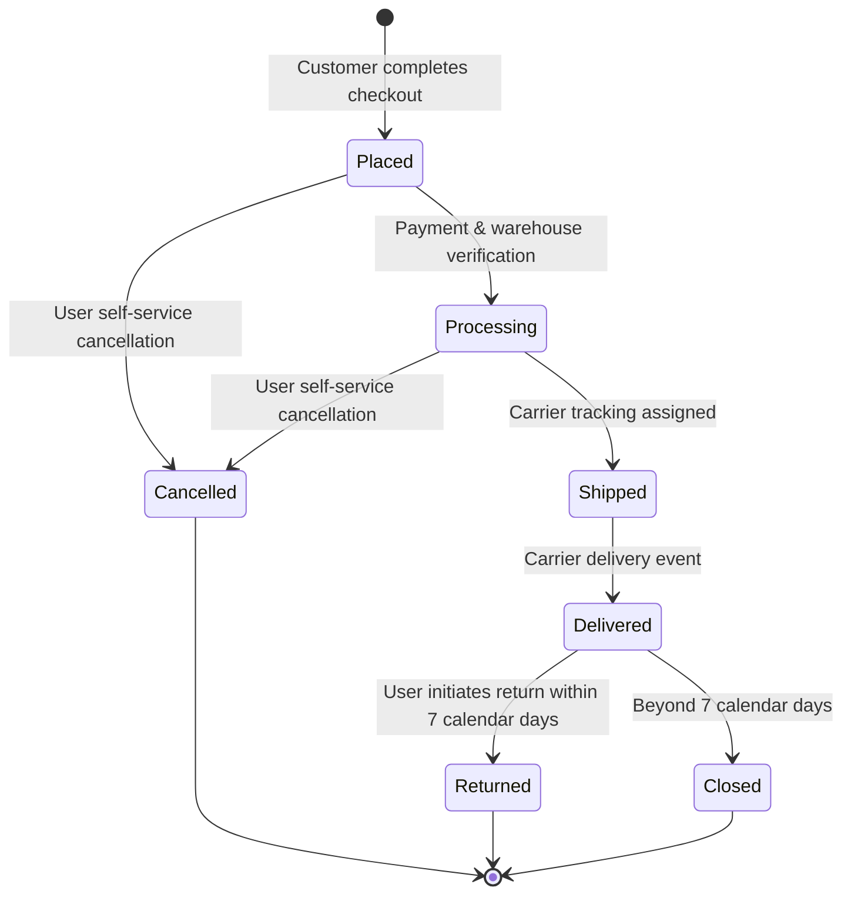

# GoodFind — System Architecture & Design Documentation

## 1. Executive System Overview
GoodFind is a direct-to-consumer (D2C) e-commerce storefront and fulfillment orchestration engine designed for high-end workspace provisions, studio audio hardware, everyday linen apparel, and handcrafted home objects. 

The platform is designed around three architectural tenets:
1. **Zero-Lag Interactive Client Architecture**: Sub-second client interactions powered by optimistic UI updates, local state persistence, and modular component isolation.
2. **Resilient Session & State Model**: Dual-layer state architecture pairing lightweight client-side state with MongoDB Atlas session and order persistence.
3. **Self-Service Post-Purchase Lifecycle**: End-to-end package tracking, split-shipment derivation, instant invoice rendering, self-service order cancellations, and 7-day automated return label provisioning.

---

## 2. Frontend Architecture & UI/UX Design System

### 2.1 Technology Stack
- **Framework**: React 19 (ESNext / JSX)
- **Build Tool**: Vite 8 (Hot Module Replacement, tree-shaking, code-splitting via Rollup)
- **Styling**: Tailwind CSS with custom HSL-based dark/light theme tokens and CSS variables
- **Icons**: Lucide React
- **Notifications**: Sonner (toast notification queue)

### 2.2 Design Philosophy & Accessibility
- **Visual Tone**: Editorial minimalism with high typographic contrast (`Plus Jakarta Sans` for headers/body and `JetBrains Mono` for order numbers, SKUs, and tracking IDs).
- **Surface Elevation**: Layered semi-transparent cards with backdrop-blur (`bg-card/70 backdrop-blur-sm`), soft borders (`border-border/80`), and elevation shadows (`shadow-soft` to `shadow-card`).
- **Accessibility (a11y)**:
  - Strict semantic HTML (`<main>`, `<header>`, `<article>`, `<section>`, `<nav>`).
  - ARIA attributes (`aria-expanded`, `aria-label`, `role="dialog"`).
  - High contrast color ratios across light and dark modes.
  - Safe hover bridge geometry on interactive dropdowns to eliminate pointer-gap flicker.

### 2.3 Modular Feature Architecture
The codebase follows domain-driven folder isolation:
```text
frontend/src/
├── components/          # Reusable atomic UI elements (buttons, dialogs, inputs, sheets)
├── features/            # Isolated domain features
│   └── orders/          # Dedicated order domain (types, steppers, split-shipments, modals)
├── pages/               # Route-level views (storefront, catalog, checkout, policies)
├── store/               # Global state stores (cartStore, authStore, productStore, theme)
└── data/                # Seed definitions and prebaked static fallbacks
```

---

## 3. State Management & Data Flow



### 3.1 Client State Synchronization
- **Guest vs. Authenticated Shopping**: Cart items persist across sessions via `localStorage`. Upon checkout or login, guest sessions seamlessly bind customer profiles to orders.
- **Order Isolation**: The `useOrders` hook isolates orders strictly per authenticated user (`customer.id` or normalized `customer.email`), preventing test mock data or sibling user orders from contaminating newly created accounts.

---

## 4. Backend Service Architecture & Session Management

### 4.1 Server Framework
- **Runtime**: Node.js 22 LTS / 24
- **Web Framework**: Express 4
- **Security**: CORS origin validation, helmet HTTP headers, parameterized queries, and bcrypt password hashing (10 salt rounds).

### 4.2 Production Session Architecture
- To eliminate memory leaks and allow horizontal scaling past a single process, session storage is backed by **`connect-mongo`** (`MongoStore.create({ mongoUrl, collectionName: 'sessions', ttl: 14 * 24 * 60 * 60 })`).
- Cookies utilize `httpOnly: true`, `sameSite: 'lax'`, and dynamic `secure: process.env.NODE_ENV === 'production'`.

### 4.3 Keepalive & Cold-Start Optimization
- **Endpoint**: `GET /api/health`
- **Design**: Zero database dependency. Returns `{ status: 'ok', timestamp: '...' }` in `< 2ms` with `200 OK`.
- **Purpose**: Compatible with external HTTP ping monitors (UptimeRobot, Cron-Job.org, BetterUptime) hitting every 14 minutes to prevent Render free-tier web services from entering inactivity sleep.

---

## 5. Order Lifecycle & 7-Day Return State Machine



### 5.1 Business Rules
1. **Cancellation Window**: Allowed only when order status is `placed` or `processing`. Once marked `shipped` or `in transit`, cancellation is disabled to prevent goods loss in transit.
2. **7-Day Happiness Guarantee**: Return requests are enabled exclusively for orders in `delivered` status within 7 calendar days (`Date.now() - deliveredAt <= 7 * 24 * 60 * 60 * 1000`).
3. **Automated Return Label Generation**: Self-service returns immediately generate a carrier-compliant RMA tracking identifier (`RET-XXXXXX`) and downloadable return manifest.

---

## 6. Database Models (MongoDB Atlas)

### 6.1 Users Collection
- `name`: String (Customer display name)
- `email`: String (Unique, lowercase index)
- `password`: String (Bcrypt hash)
- `role`: Enum (`customer`, `admin`)
- `savedAddresses`: Array of Address Sub-documents
- `createdAt` / `updatedAt`: ISO Timestamps

### 6.2 Orders Collection
- `orderNumber`: String (Indexed business ID, e.g., `GF-84291`)
- `customer`: Object containing `id`, `name`, `email`, `phone`
- `items`: Array of Line Items (`productId`, `name`, `price`, `quantity`, `image`, `selectedOptions`)
- `shippingAddress`: Full physical delivery address snapshot
- `status`: Enum (`placed`, `processing`, `shipped`, `delivered`, `cancelled`, `returned`)
- `payment`: Method, status, and transaction references
- `pricing`: Subtotal, shipping, tax, discount, and grand total
- `trackingNumber` & `trackingUrl`: Carrier dispatch references
- `milestones`: Array of delivery status timestamps

---

## 7. Deployment Architecture (Render)

### 7.1 Backend Web Service
- **Environment**: Node
- **Root Directory**: `backend`
- **Build Command**: `npm install`
- **Start Command**: `node index.js`
- **Environment Variables**:
  - `PORT`: `5000` (or injected by Render)
  - `MONGODB_URI`: MongoDB Atlas connection string with credentials and database name
  - `SESSION_SECRET`: Cryptographically secure random secret
  - `NODE_ENV`: `production`

### 7.2 Frontend Static Site / Web Service
- **Build Command**: `npm install && npm run build`
- **Publish Directory**: `dist`
- **Vite Proxy / API Target**: Pointed via `VITE_API_URL` to the production backend URL.

